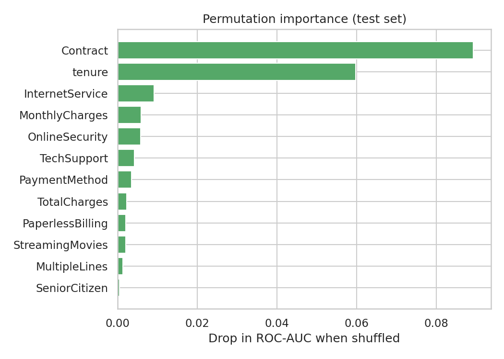

# 📉 Customer Churn Prediction

An end-to-end machine learning project that predicts which telecom customers are likely to leave, **chooses the decision threshold from business cost instead of the default 0.5**, and ships as an interactive Streamlit app with what-if retention scenarios.

> Final project, Module 6 (AI & ML). Built with Python, scikit-learn and Streamlit.

## Why this problem?
Winning a new customer costs far more than keeping one, and the same logic drives every subscription/SaaS business. A churn model is only useful if it changes decisions, so this project goes beyond accuracy: it asks *how many customers can we save, and at what cost?*

## Results (held-out test set, 1,409 customers)

| Metric | Default threshold (0.50) | Cost-optimised threshold (0.25) |
|---|---|---|
| ROC-AUC | 0.846 | 0.846 |
| Recall (churners caught) | 80.2% | **94.7%** |
| Precision | 51.3% | 40.4% |
| Accuracy | 74.5% | 61.5% |

- **Baseline:** always predicting "stays" gives 73.5% accuracy, so accuracy alone is misleading on this imbalanced data (26.5% churn). ROC-AUC and recall matter more.
- **Business impact (assumption: a lost customer costs 10x a retention offer):** total cost drops from 187,000 (no model) to 66,250 at the default threshold and **53,800 at the tuned threshold, a 71% reduction**. Accuracy falls at the tuned threshold on purpose: missing a churner is costlier than contacting someone who would have stayed.
- The 10x cost ratio is an assumption. Change `COST_MISSED_CHURNER` and `COST_RETENTION_OFFER` in `src/train.py` to match a real business.

### Model comparison (5-fold CV ROC-AUC on training data, after grid search)
| Model | CV ROC-AUC |
|---|---|
| Logistic Regression | 0.846 |
| Random Forest | 0.847 |
| **Gradient Boosting** | **0.848** |

The three models are very close, which suggests the dataset's signal ceiling is near 0.85. Gradient Boosting was selected as the best.

### What drives churn?
Permutation importance on the test set shows **Contract type** and **tenure** dominate, followed by internet service, monthly charges, online security and tech support. Month-to-month customers with short tenure are the highest risk.



More figures are in [`reports/figures/`](reports/figures): target balance, churn by category, distributions, model comparison, ROC curve, confusion matrices and the threshold-vs-cost curve.

## Method
1. **Data:** IBM Telco Customer Churn dataset (7,043 customers, 20 features). Blank `TotalCharges` values belong to brand-new customers (tenure 0) and are set to 0.
2. **Features:** engineered `n_addons` (number of add-on services). One-hot encoding for categoricals and scaling for Logistic Regression, all inside one scikit-learn `Pipeline` so there is no train/test leakage.
3. **Split:** stratified 80/20 train/test.
4. **Modelling:** three models tuned with `GridSearchCV` (5-fold, ROC-AUC), class imbalance handled with class weights.
5. **Threshold:** picked from out-of-fold *training* predictions by minimising business cost, then evaluated once on the untouched test set.
6. **Explainability:** permutation importance on raw features.

### Responsible ML notes
- `gender` is excluded from the features: it is a protected attribute and adds no signal.
- The what-if scenarios in the app show model *associations*, not proven causal effects. Offers should be A/B tested before rollout.
- `TotalCharges` in the app is estimated as monthly charges x tenure.

## Project structure
```
├── app.py                  # Streamlit app (prediction + what-if scenarios)
├── data/telco_churn.csv    # dataset
├── src/preprocessing.py    # loading, cleaning, feature engineering
├── src/train.py            # training, tuning, evaluation, figures
├── models/                 # saved model + metrics.json
├── reports/figures/        # EDA and evaluation plots
└── tests/                  # pytest checks
```

## Run it
```bash
git clone https://github.com/aakashsingh-7/churn-prediction.git
cd churn-prediction
pip install -r requirements.txt

python -m src.train         # optional: retrain and regenerate models/ and reports/
streamlit run app.py        # launch the app
pytest                      # run tests
```
Run `python -m src.train` from the project root so the saved pipeline stays importable.

## Limitations and next steps
- One dataset from one telecom provider; results may not transfer to other businesses.
- Test set is a single random split. Time-based validation would be more realistic.
- Next: probability calibration, SHAP explanations per customer, and deploying the app on Streamlit Community Cloud.

## Data source
IBM Telco Customer Churn sample dataset (IBM/telco-customer-churn-on-icp4d on GitHub).
